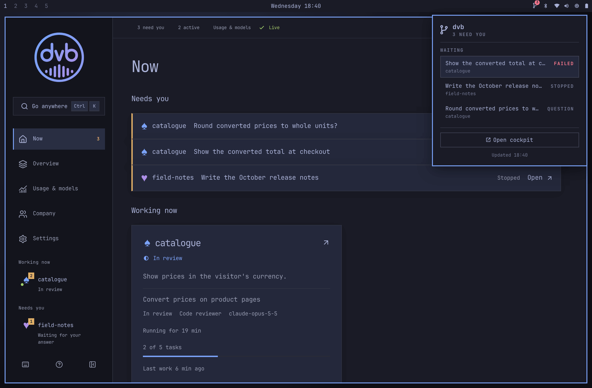

# dvb for the Omarchy bar

A bar widget for [Omarchy](https://omarchy.org) that shows when
[dvb](https://github.com/broken-branch/dvb#readme) needs you.



*A rendered mock-up, not a screenshot: on your machine the colours and sizes
follow your Omarchy theme.*

## What it shows

- **One bar icon with a count badge**, only while something waits for you: a
  plan to approve or an open question, or a failed or stopped task (dvb's
  "need you" count). When nothing waits, the icon takes no space in the bar.
- **A panel** (left click) listing each waiting item: the question's subject
  or the task's title, its kind (`QUESTION`, `FAILED` or `STOPPED`) and the
  project. Hover a failed task to read why it failed.
- **Clicks open dvb's cockpit**: an item opens its page with
  `dvb app --route`, and "Open cockpit" (or a right click on the icon) runs
  `dvb app`. A middle click, or `r` in the panel, refreshes now.

It reads `dvb status --bar` for the count and `dvb status --json` for the list,
every 30 seconds by default (set **Refresh interval** in the widget's settings,
10 to 600 seconds). When `dvb` is not installed, its engine is not reachable or
a call does not finish within 15 seconds, the widget stays hidden and writes
one line to the shell log.

## Install

Install dvb first, as its [README](https://github.com/broken-branch/dvb#readme)
describes, so `dvb` is on your `PATH`. Then:

```sh
omarchy plugin add https://github.com/broken-branch/omarchy-dvb --enable
```

Plugins are added disabled; `--enable` turns this one on and puts the widget
in the bar's right section. If you added it without `--enable`, run
`omarchy plugin enable io.github.broken-branch.dvb`. To put it somewhere else
in the bar, use `omarchy bar move`, for example
`omarchy bar move io.github.broken-branch.dvb --section left`.

The widget installs nothing else and never asks for `sudo`.

## License

[MIT](LICENSE)
